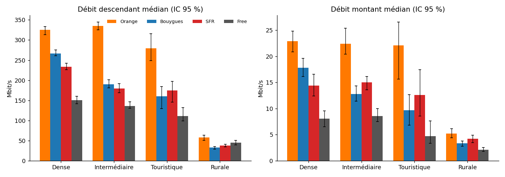
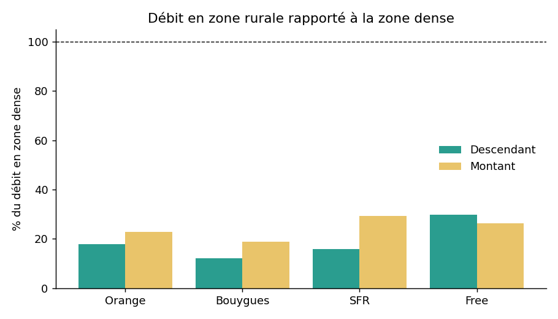
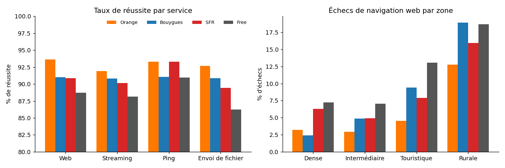
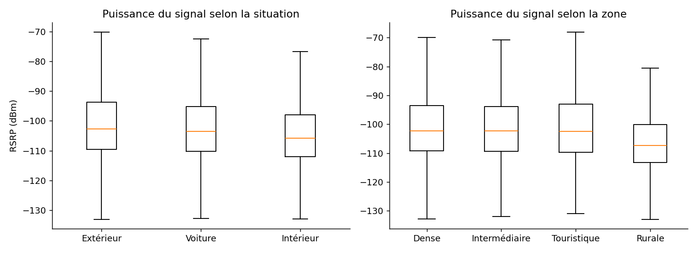
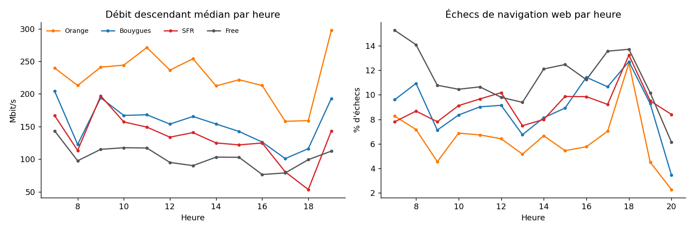
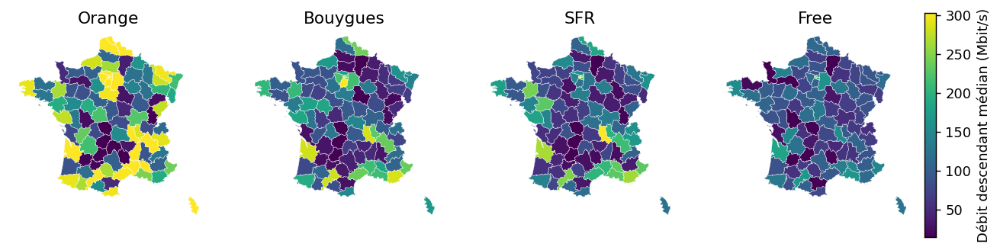
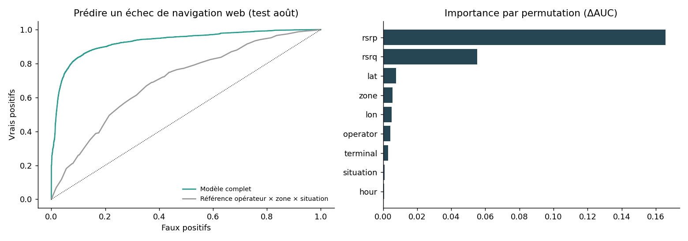
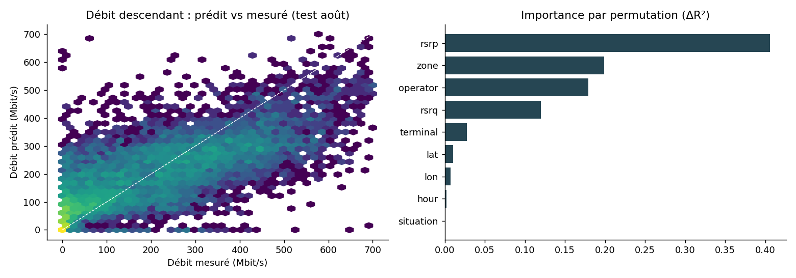
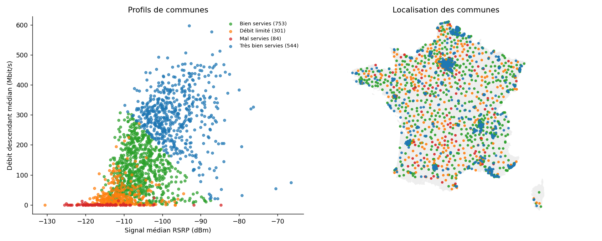

# 📶 5G-QoS France 2025
**Qualité de service mobile 5G en France métropolitaine** — analyse de 354 282 mesures réelles (mai-septembre 2025, 4 opérateurs, 1 682 communes) : comparaison des opérateurs, fracture rurale, cartes par département, modèles prédictifs, profils de communes et tableau de bord interactif.

## Questions posées
1. Quel opérateur offre les meilleurs débits, en zone dense comme en zone rurale ?
2. Quelle est l'ampleur de la fracture entre zones denses et rurales ?
3. Quels départements sont les moins bien servis ?
4. Qu'est-ce qui explique l'échec d'un test web ou la baisse de débit ?
5. Quelles communes sont mal servies, et comment les regrouper ?

## Résultats principaux
| Indicateur | Résultat |
|---|---|
| Débit descendant médian | Orange 232 · Bouygues 155 · SFR 131 · Free 101 Mbit/s |
| Zone dense vs rurale | 244 vs 41 Mbit/s (le rural atteint 12 à 30 % du dense selon l'opérateur) |
| Perte à l'intérieur | −3,2 dB de signal, −28,5 % de débit |
| Départements les moins bien servis | Lot, Aisne, Corrèze, Creuse (< 12 Mbit/s médian) |
| Prédire un échec web (test août) | ROC-AUC 0,93 (référence simple : 0,70) |
| Prédire le débit | R² 0,55 (référence : 0,20) |
| Communes mal ou peu servies | 385 sur 1 682, surtout rurales |

Rapport complet : [`reports/rapport.md`](reports/rapport.md)

## Aperçu
### Débits par opérateur et par zone


### Écart entre zone rurale et zone dense


### Fiabilité des services


### Signal radio : intérieur, extérieur, voiture


### Effet de l'heure


### Carte des débits par département


### Prédire un échec de navigation web


### Prédire le débit descendant


### Profils de communes


## Structure
```
qos-5g-france-2025/
├── app/streamlit_app.py     tableau de bord interactif
├── data/                    échantillon, agrégats, contours (voir data/README.md)
├── src/clean.py             nettoyage + échantillon + agrégats
├── src/analysis.py          analyses, modèles, figures
├── figures/  reports/       résultats
└── requirements.txt
```

## Lancer le projet
```bash
python -m venv .venv && .venv\Scripts\activate      # Mac/Linux : source .venv/bin/activate
pip install -r requirements.txt

# Tableau de bord (fonctionne directement avec les données versionnées)
streamlit run app/streamlit_app.py

# Pour tout régénérer : placer le fichier brut dans data/raw/ puis
python src/clean.py
python src/analysis.py
```

## Méthodes
Pandas pour le nettoyage, agrégats exacts pour toutes les combinaisons de filtres, intervalles de confiance par bootstrap, `HistGradientBoosting` (scikit-learn) avec **découpage temporel** (entraînement jusqu'au 31 juillet, test sur août), importance par permutation, KMeans pour les profils de communes, Plotly et Streamlit pour le tableau de bord.

## Points d'attention sur les données
- Pour le téléchargement et l'envoi, « Success » signifie « fichier transféré dans le temps imparti », pas « le service fonctionne » : l'analyse se fait sur les débits.
- Toutes les mesures démarrent en 5G ; elles ont été faites en journée.
- Le fichier brut (93 Mo) n'est pas versionné ; voir `data/README.md` pour la source et la reproduction.

## Licence
Code libre d'usage. Les données brutes restent soumises aux conditions de leur source officielle.
